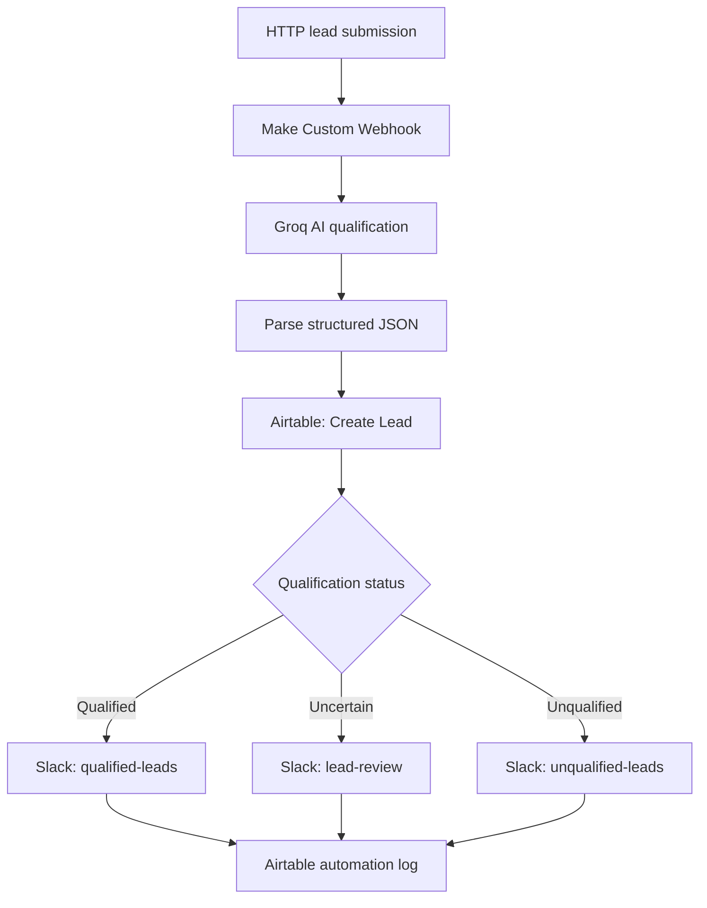

# Architecture

## End-to-end flow

1. **Webhook intake** — Make Custom Webhook receives a JSON lead submission.
2. **AI qualification** — Groq receives the submitted lead fields and qualification instructions.
3. **Parse response** — Make JSON parser extracts the structured classification and supporting fields.
4. **Persist lead** — Airtable creates a record in the `Leads` table.
5. **Route by classification** — Make router directs the lead to one of three Slack channels.
6. **Log outcome** — Airtable `Automation Logs` records the processing event.

## Data flow

## Qualification principles

- Return one of: `Qualified`, `Unqualified`, or `Uncertain`.
- Do not fabricate company size, budget, or other lead attributes.
- Treat missing or ambiguous qualification data as `Uncertain`.
- Provide a concise summary, reason, talking points, and missing-information notes.
- Treat any AI score as a prioritization aid, not a verified fact or final business decision.
- Human review remains appropriate for uncertain or high-impact decisions.

## Airtable schema

### Leads

| Field | Type / allowed values |
|---|---|
| Lead Name | Single line text |
| Email | Email |
| Company | Single line text |
| Company Size | Single line text |
| Budget | Single line text |
| Lead Source | Single line text |
| Qualification Status | Single select: Qualified, Unqualified, Uncertain |
| AI Summary | Long text |
| Qualification Reason | Long text |
| Created At | Created time |

### Automation Logs

| Field | Type / allowed values |
|---|---|
| Event ID | Single line text |
| Lead Email | Email |
| Processing Status | Single select: Success, Failed, Needs Review |
| Error Details | Long text |
| Processing Time (ms) | Number |
| Created At | Created time |

The latest verified uncertain-path run wrote a log with status `Needs Review`. Processing time was not populated in the final audited configuration.

## Slack destinations

- `#qualified-leads`
- `#lead-review`
- `#unqualified-leads`

The final verified run delivered a notification to `#lead-review`. The other two routes were configured but not verified by that final test.
